# Codea Air Code

This extension connects Visual Studio Code to the [Codea](https://codea.io/) iOS application. Your projects are kept in a folder on your computer, in sync with Codea, so you can edit them with Visual Studio Code and any other tool, then play, tweak and debug them on your device. Auto-completion and documentation features similar to Codea are available while working on the projects.

## Table of Contents 

- [Features](#features)
  - [Projects in Local Folders](#projects-in-local-folders)
  - [Editor](#editor)
  - [Sidebar](#sidebar)
  - [Device Preview](#device-preview)
  - [Debugger](#debugger)
- [Installation](#installation)
- [Usage](#usage)
  - [Getting Started](#getting-started)
  - [Linked Folders](#linked-folders)
  - [Connection](#connection)
  - [USB Connection](#usb-connection)
  - [Creating, Renaming and Deleting Projects](#creating-renaming-and-deleting-projects)
  - [Files and Folders](#files-and-folders)
  - [Dependencies](#dependencies)
  - [Assets](#assets)
  - [Commands](#commands)
- [Requirements](#requirements)
- [License](#license)
- [Change Log](#change-log)

## Features

### Projects in Local Folders

Each project is kept in a regular folder on your computer, linked to the project in Codea. Because the files are local, everything works with them: Visual Studio Code's search, source control such as git, and other extensions and tools, including AI coding assistants. Changes are sent to Codea as soon as they are saved, and changes made on the device come back on their own, even while a project is running.

A folder can hold many projects, the same way Codea organizes them, so a git repository of your Codea projects can be opened and linked as it is.

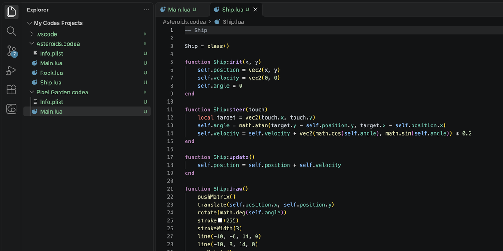

### Editor

The editor knows Codea's API and your project: auto-completion, color pickers, font and sprite lists, snippets and documentation work much like in Codea.

#### Auto-Completion

Auto-completion is available for the Codea API as well as symbols defined in the project and its dependencies.

#### Symbols

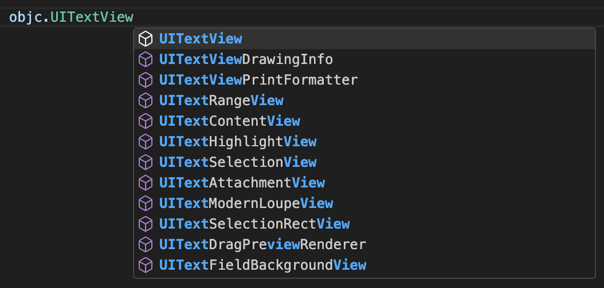

#### Colors

Methods such as `background`, `fill`, `tint`, `stroke` and `color` will show a color indicator which can be used to visualize and easily change the assigned color using VSCode's color picker.

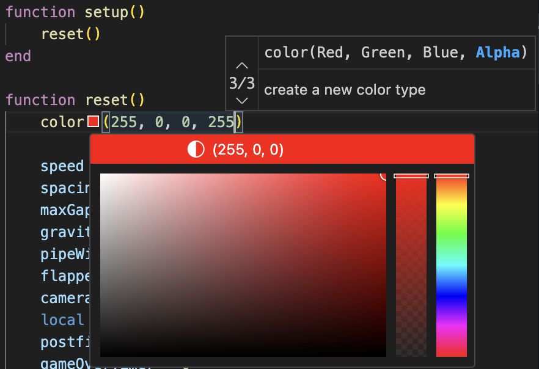

#### Font and Sprites

The `font` and `sprite` functions will automatically list the fonts and sprites available for the current project.

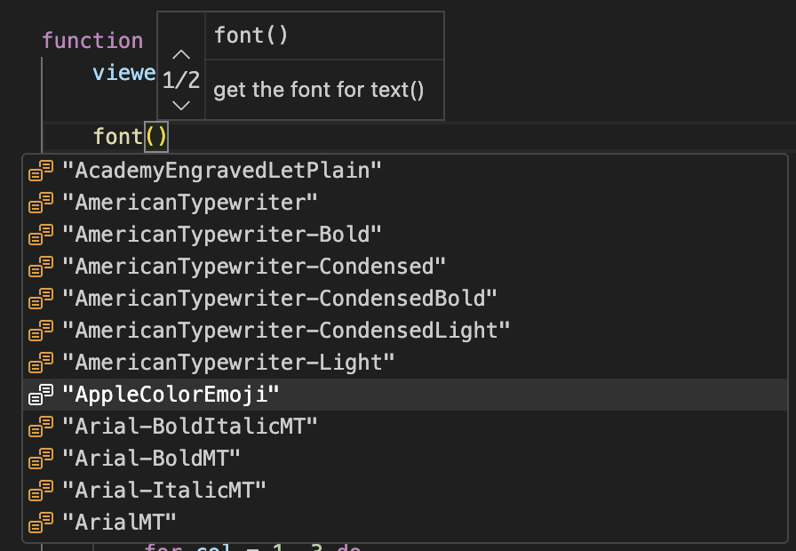

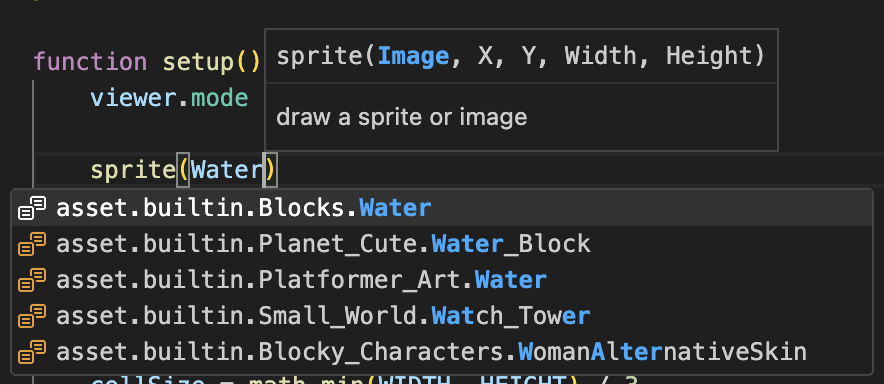

#### Snippets

Snippets make it easier to format the different Lua control structures such as `if`, `for`, `while` and `repeat`.

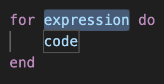

#### Documentation

Types can easily be documented using a triple-slash (`---`) comment.

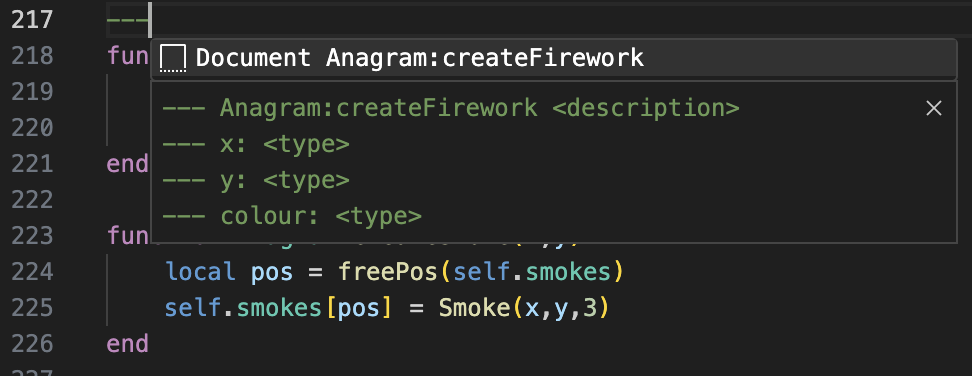

#### Go to Definition

With the [Lua extension](https://marketplace.visualstudio.com/items?itemName=sumneko.lua) by sumneko installed, Codea Air Code sets it up for your linked projects, so Go to Definition (F12), Find All References and hover work on your code and Codea's API:

- functions and variables in other tabs, in folders inside the project, and in the other linked projects, such as its dependencies;
- classes made with `class()` and their methods, as in `ship:draw()`;
- modern dependencies required with `require(asset.documents.Lib)`;
- the globals made by `parameter.number`, `parameter.integer`, `parameter.boolean`, `parameter.text` and `parameter.color`, which lead to the call that makes them;
- Codea's API, legacy and modern, with its documentation on hover.

When the Lua extension is installed, Codea Air Code offers to set it up in a folder with linked projects; or run `Codea: Set Up Go to Definition`, which also installs it. Auto-completion and signature help still come from Codea; the Lua extension adds warnings about your code, such as an unused local. Only the linked projects are read, along with the definitions of the projects in the folder they require or list in their `Info.plist`, so a folder holding many other projects, such as a git repository of them, does not slow it down or fill the Problems view. A required project is looked for beside the project that requires it, or in a folder named after its collection. A name defined in several linked projects lists each of them, and files open in an editor keep their warnings until they are closed.

A global that may not exist, checked before it is used, is reported as undefined. Tell the Lua extension it is expected on that line:

```lua
---@diagnostic disable-next-line: undefined-global
if scratchTrailColor then
```

### Sidebar

The Codea Sidebar gives access to the Projects, Assets, Reference and Parameters sections.

#### Projects

The Projects section lists the collections and projects in Codea. Click the download button next to a project to get a copy in your folder, linked to Codea (see [Linked Folders](#linked-folders)). Linked projects can be played from the list, or revealed in the Explorer.

To get all your projects at once, click the download button at the top of the section, or the one next to a collection to get all of its projects. Codea's built-in collections, such as Examples, are left out of the first, but each of their projects can still be got on its own.

The New Project button at the top of the section, or next to a collection, creates a project in Codea and gets it (see [Creating, Renaming and Deleting Projects](#creating-renaming-and-deleting-projects)). A linked project lists its dependencies under it (see [Dependencies](#dependencies)), and projects in iCloud are marked with a cloud in the Explorer.

The filter button at the top of the section shows only the linked projects and the collections holding them; click it again to show all projects.

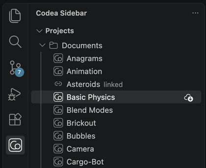

#### Assets

The Assets section lists Codea's asset packs: your Documents and iCloud Documents, your external folders, and the packs that come with Codea. Click a file to open it, or drag it into a Lua file to insert its asset key (see [Assets](#assets)).

#### Reference

The Codea Reference section of the Sidebar contains the full documentation for Codea Legacy (3.x) and Modern (4.x) which can be navigated by clicking on the different chapters and functions.

It is also possible to select and right click a word in a project's code to find the corresponding reference in the Legacy documentation (or using the `Find reference...` command), automatically focusing on the sidebar and opening the corresponding page.

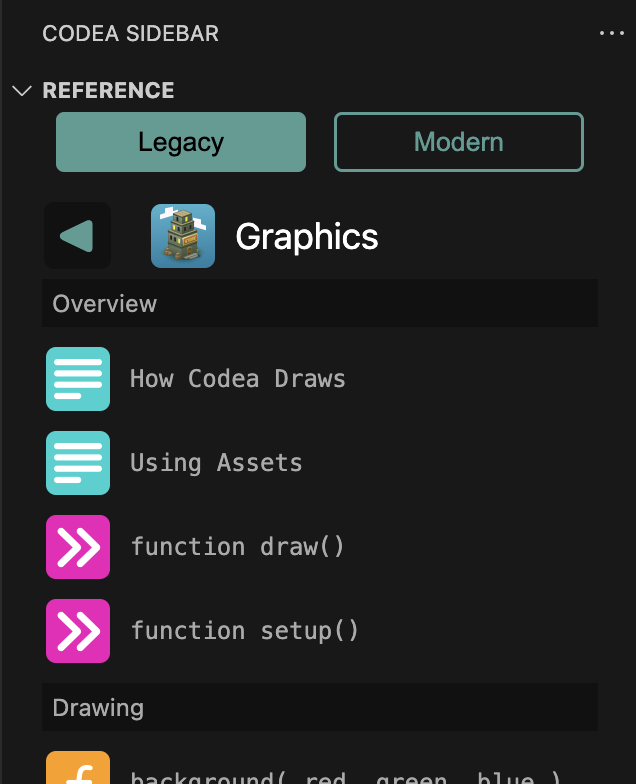

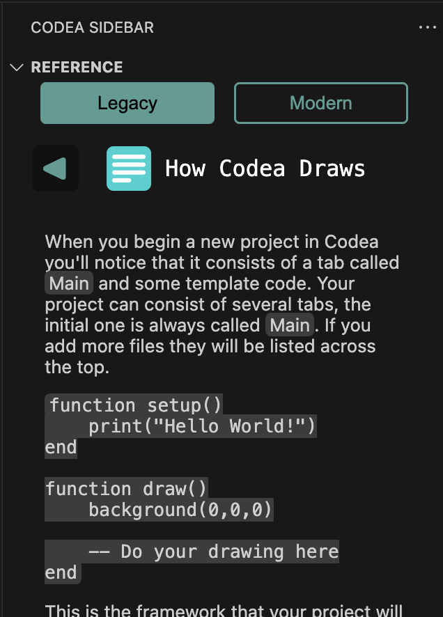

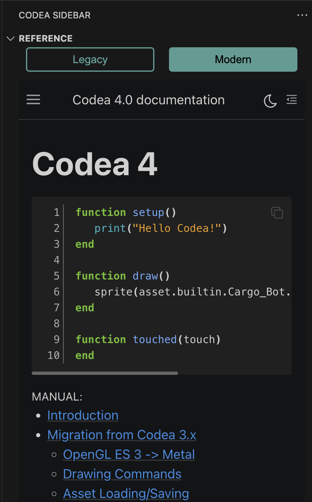

#### Search

The files are on your computer, so Visual Studio Code's own search works as usual, across all your projects.

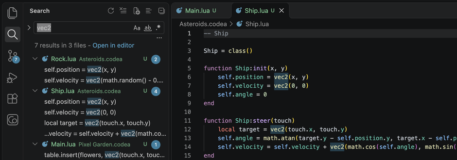

#### Parameters

The second section of the Codea Sidebar will show the current parameters for the running project, if any.

All parameters can be controlled directly from Visual Studio Code even if the parameters are hidden in Codea, making it easier to tweak the projects.

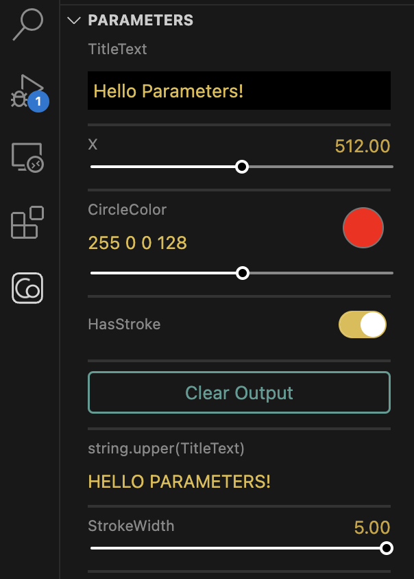

### Device Preview

Click the device button in the status bar, or run `Codea: Show or Hide the Device's Screen`, to see the device in a panel beside your code. `Project` shows only the running project, without Codea's buttons, and greys out when no project is running; `Screen` shows the whole screen with Codea's own interface. The panel can be resized or moved to its own window, and zoomed to fit, to the device's actual size, or to half or twice that.

Showing the project, click or drag on it to touch it: the project's `touched` function gets the touch as if it came from the screen, one finger at a time.

The first time the panel opens, iOS asks whether Codea may record its screen. Allowing it lets Codea send frames without slowing the project down; otherwise Codea draws each frame itself, which costs the project some of its frame rate. Frames are only asked for while the panel is visible, and not while files sync.

### Debugger

With a project running, Visual Studio Code can be used to attach to the running project and then used for debugging.

Values of variables and watches can be modified while the execution is paused.

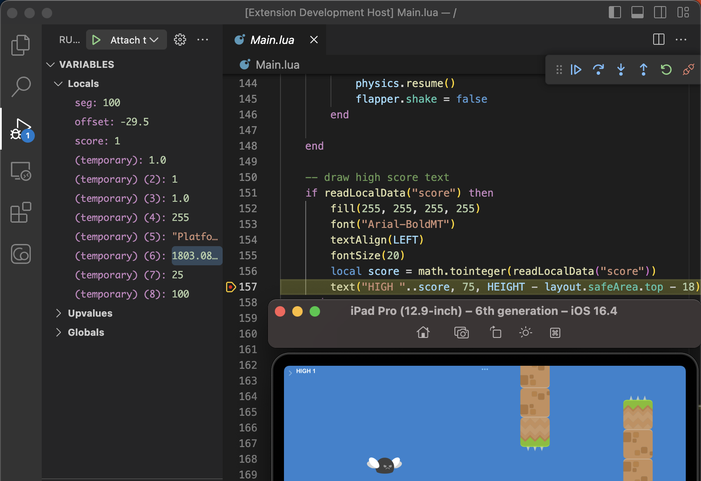

#### Conditional Breakpoints

To set a condition on a breakpoint, right click a breakpoint and select `Edit Breakpoint...`:

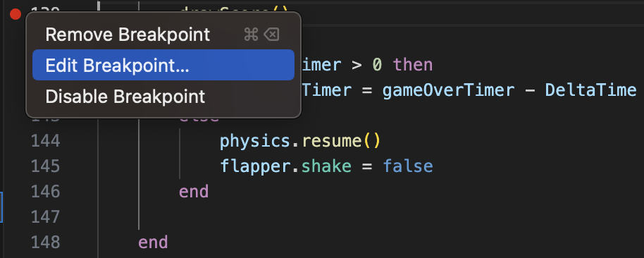

Enter a valid Lua expression which must be `true` for the breakpoint to hit.

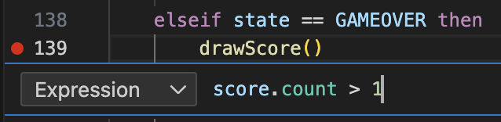

#### Log Points

Log Messages can be set on breakpoints to print the message in the Debug Console instead of breaking the execution. This can also be used to print the result of expressions within curly braces as can be seen in the following example:

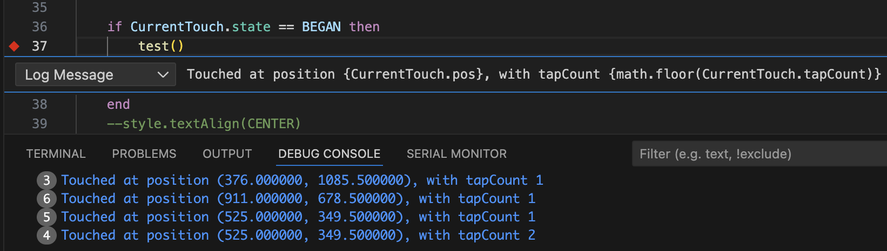

## Installation

Search for "Codea Air Code" in Visual Studio Code's Marketplace and install the extension.

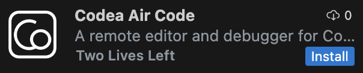

## Usage

### Getting Started

The `Codea: Get Started with Codea Projects` command opens a walkthrough of these steps.

1. Open a folder for your projects with `File > Open Folder...`: an empty folder to start, or one you already have, such as a git repository of Codea projects.
2. In the Codea Sidebar, open the Projects section and click `Connect to Codea` (see [Connection](#connection)).
3. Click the download button next to a project to get it, or the one at the top of the section to get all your projects. Projects are copied into your folder the same way Codea organizes its files (`Project.codea` for Documents, `Collection/Project.codea` for other collections).
4. If your folder already holds your projects, laid out the same way, run `Codea: Link All Matching Folders...` to link them all to the projects of the same name in Codea, or right-click one project's folder in the Explorer and choose `Codea: Link Folder to Project...`. A project folder that Codea does not have yet is linked with `Codea: Link Folder to a New Project...`, which makes the project in Codea, in the collection the folder is in, with the folder's files; Link Folder to Project offers the same at the top of its list.
5. Edit the project, then play it with the play button in the status bar.

### Linked Folders

A linked folder is a regular folder on your computer that the extension keeps in sync with a project in Codea. Playing, debugging, auto-completion and parameters work with Codea as they would on the device.

Links are saved in the workspace's `.vscode/settings.json`:

```json
{
    "codea-air-code.host": "192.168.1.10:18513",
    "codea-air-code.links": {
        "EmuTests.codea": "iPad Projects/EmuTests"
    }
}
```

Changes are kept in sync both ways:

- Files saved here, created, deleted, or changed by any other tool are sent to Codea right away.
- Changes made in Codea, or by another app on the device, come back within a second. With older versions of Codea, linked folders are checked every 10 seconds instead.
- If a file changed on both sides, you will be asked whether to keep the local version or Codea's, and you can compare them first. Nothing is overwritten until you choose. After linking, reloading or reconnecting, the files that differ are asked about together in a dialog, to keep one side for all of them or review each. A file still waiting for a choice is not synced, and the status bar shows how many there are; click it, or run `Codea: Resolve Sync Conflicts`, to choose.

Deletions are handled carefully, since Codea deletes files for good:

- A file deleted here is deleted in Codea only if the deletion happens while the folder is connected. A file found missing on one side when the folder connects is brought back from the other, and the output says so.
- Deleting more than 5 files at once asks first; anything but `Delete in Codea` brings them back.
- `Main.lua` and `Info.plist` are put back if they are deleted, and `Main.lua` is renamed back if it is renamed: Codea projects need them.
- A linked project whose folder goes missing, here or in Codea, is not synced. You are asked whether to get it again or unlink it, and nothing is changed in Codea.

To stop syncing a folder, right-click it in the Explorer, or its project in the Projects section, and choose `Unlink Folder`. Its files stay as they are, here and in Codea, and it can be linked again later.

The Codea items in the status bar show the connection and play the project you are working on. Clicking the Codea item shows a menu to sync, reconnect or link a folder. Syncing can also be started with the button at the top of the Explorer.

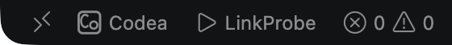

While the project is running, the play button becomes a stop button.


### Connection

To connect your folder to Codea, click `Connect to Codea` in the Projects section of the Codea Sidebar, or run the `Codea: Connect to Codea...` command from the Command Palette (Ctrl+Shift+P on Windows, ⇧⌘P on Mac). Visual Studio Code will ask to select a device or enter the IP and port to connect to:

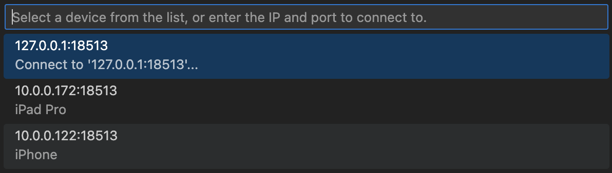

A device plugged in with a USB cable is listed first, by name, when Codea is open on it (see [USB Connection](#usb-connection)). To find the device's IP to connect to if the device is not in the list, use the Air Code icon on the project selection screen in Codea. The default port is `18513`. The address is saved with the folder's settings, so the folder reconnects on its own the next time it is opened.

Clicking the Codea item in the status bar shows a menu to disconnect, reconnect, or connect to another device. While disconnected, changes stay where they are made, and are synced when the folder connects again.

#### Fun Fact

> The idea for this extension started as a proof-of-concept of a browser based "Remote Console". The idea was to see a Codea project's logs and execute commands directly from a web browser.
>
> Air Code's default port 18513 is actually based on the letters R (18) E (5) M (13), for REMote console.

### USB Connection

If Wi-Fi is not accessible or is slow, you can connect to Codea over a USB cable. Plug the device in, open Codea, and choose it at the top of the list when connecting: devices on USB where Codea answers are listed first, by name. This goes through the service that Finder and Xcode use to reach a device, which is part of macOS; on Windows it comes with Apple's device support (the Apple Devices app or iTunes).

You can also connect through iproxy, a utility part of libusbmuxd (`brew install libusbmuxd` on Mac and Linux): instead of an address, enter the port used in Codea for Air Code followed by a local port to open on your computer, for example `18513:18514`.

#### Multi-window

Air Code does not currently support multiple Codea windows or running projects. For this reason, when running a project from Air Code, all windows will be closed except one before running the project.

### Creating, Renaming and Deleting Projects

To create a project, click the New Project button (the Codea logo with a plus) at the top of the Explorer or of the Projects section, or right-click a folder in the Explorer and choose `Codea: New Project...`. From a folder, the project goes in the collection that folder stands for: the workspace folder for Documents, a folder at the top for a collection of that name, which is created in Codea if needed. The project is created in Codea from your default template, then got and linked like any other.

Renaming a linked project's folder in Visual Studio Code renames the project in Codea. The `.codea` extension is added back if it is left out, so renaming `Game.codea` to `Racer` gives `Racer.codea` and a project named Racer. If Codea cannot take the name, for example because it already has a project named so, the folder is renamed back. A project folder moved elsewhere stays linked to the same project.

Deleting a project's folder never deletes the project in Codea. To delete a project in Codea, right-click its folder in the Explorer, or the project in the Projects section, and choose `Delete Project in Codea...`: it asks first, then deletes the project in Codea and moves the folder to the Trash.

### Files and Folders

Files added, removed or renamed in a project's folder, from Visual Studio Code or any other tool, are added, removed or renamed in Codea as well. A renamed tab keeps its place among Codea's tabs.

Folders inside a project are kept in sync too, with a version of Codea that keeps them. With an older one, a file moved into a folder is put back and left in Codea, and the output says so.

### Dependencies

A linked project lists its dependencies under it in the Projects section, as Codea's editor lists them: the projects its code requires with `require(asset.documents.Project)` on the modern runtime, those in its `Info.plist` on the legacy one. Right-click the project and choose `Add dependency...` to add one, or use the command on the project of the file being edited, and click the cross next to a dependency to remove it. Codea writes the change, and the project's `Main.lua` or `Info.plist` comes back to the folder.

When a dependency is linked too, the debugger opens its files in its own folder, and breakpoints set there stop in the projects that use it.


### Assets

Assets kept in a project, such as images, sounds and models, are part of its folder and are synced like any other file, so new assets can be added by copying them into the project's folder.

To reference an asset in a project, drag-and-drop the asset from the Explorer view **while holding the Shift key** into a Lua file and the Asset Key will automatically be added. Assets in the Assets section of the Codea Sidebar drag into a Lua file the same way.

Packs Codea lets you change, such as Documents, take new files with the add button next to them or by dropping files on them, and their assets can be renamed (F2, or Enter on Mac) and deleted (Delete, or ⌘⌫ on Mac).

To work on a pack's files as ordinary files, click the link button next to it: the pack is kept in `Assets/<Pack>` in your folder, in sync like a project, so the Explorer, source control and other tools work with it. The Documents packs hold only their own files: their folders are your collections and projects, which the Projects section gets.

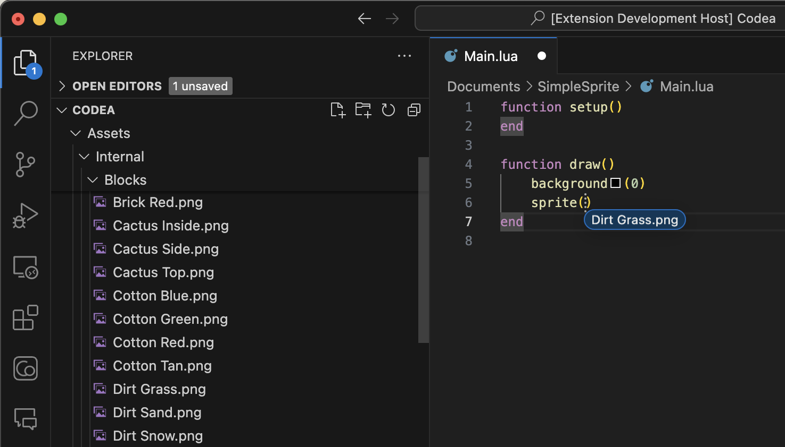

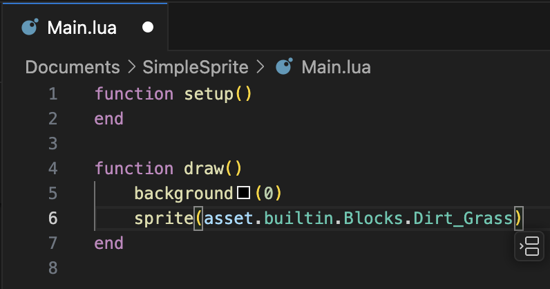

### Commands

All commands included with this extension are prefixed with `Codea:`.

| Command                | Description                                                           |
|------------------------|-----------------------------------------------------------------------|
| `Get Started with Codea Projects` | Open the walkthrough of working with Codea projects.       |
| `Connect to Codea...`  | Connect the open folder to Codea, to get and link its projects.       |
| `Get All Projects`     | Get every project from Codea into the open folder, linked.            |
| `Link All Matching Folders...` | Link the folder's projects to the projects of the same name in Codea. |
| `Link Folder to Project...` | Keep a local folder in sync with a project in Codea.             |
| `Link Folder to a New Project...` | Make a project in Codea from a local project folder, and keep them in sync. |
| `New Project...`       | Create a project in Codea and get it into the folder, linked.         |
| `Delete Project in Codea...` | Delete a project in Codea, and move its linked folder to the Trash. |
| `Sync Linked Folders`  | Sync all linked folders with Codea now.                               |
| `Unlink Folder`        | Stop syncing a folder with its project; its files stay on both sides. |
| `Disconnect`           | Disconnect the folder from Codea until you connect again.             |
| `Execute current line` | Executes the Lua code on the active line.                             |
| `Execute selection`    | Executes the select Lua code in Codea.                                |
| `Execute command...`   | Enter a Lua command to execute in Codea.                              |
| `Restart project`      | Restart the running project in Codea.                                 |
| `Add dependency...`    | Add a dependency to a project, as Codea's editor does.                |
| `Find reference...`    | Look-up the reference for the selected word.                          |
| `Set runtime...`       | Change the current project's runtime between legacy and modern.       |
| `Set Up Go to Definition` | Set up the Lua extension for Go to Definition in the linked projects, installing it if needed. |
| `Show or Hide the Device's Screen` | Show the running project, or the device's whole screen, in a panel beside your code. |

## Requirements

Codea 3.10. Folders inside projects, the dependencies of modern projects and the device preview need Codea 3.20. With versions of Codea that do not report changes made on the device, linked folders are checked for them every 10 seconds.

<a href="http://itunes.apple.com/app/id439571171?mt=8"></a>

## License
[MIT License](LICENSE)

## Change Log
See the change log [here](CHANGELOG.md)
